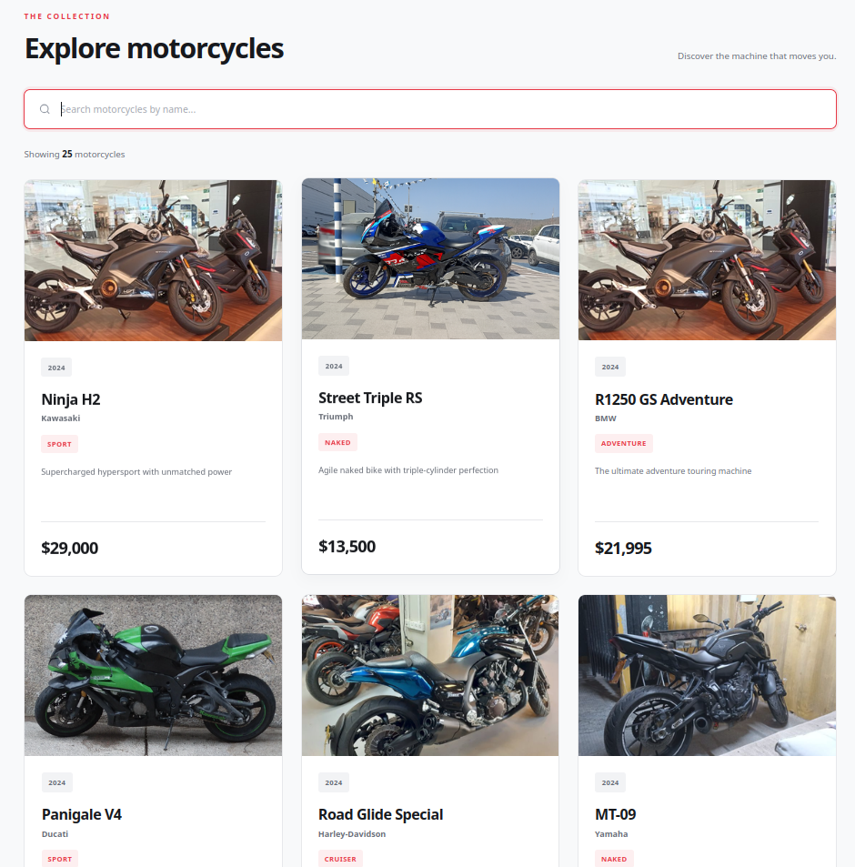

# 🏍️ Motorcycle Shop

### Discover Your Perfect Ride

A modern, responsive motorcycle catalog built with **TypeScript, Vite, and vanilla JavaScript**.

Motorcycle Shop allows users to explore a collection of 25 motorcycles, view detailed specifications, and instantly filter motorcycles by name.

The project demonstrates practical TypeScript development, asynchronous API integration, object-oriented programming, and dynamic DOM manipulation.

**Built as part of the freeCodeCamp TypeScript curriculum.**

---

## 📸 Preview



A responsive motorcycle catalog featuring dynamic product cards, real-time search, and a clean, modern interface.

---

## ✨ Features

- 🏍️ **Motorcycle Catalog** — Browse 25 motorcycles from leading manufacturers.
- 🌐 **API Integration** — Fetch motorcycle data from an external endpoint.
- ⚡ **Real-Time Search** — Instantly filter motorcycles by name without reloading the page.
- 🔢 **Dynamic Results Counter** — Automatically update the number of matching motorcycles.
- 🎨 **Responsive Design** — Optimized layouts for desktop, tablet, and mobile devices.
- 🖼️ **Dynamic Product Cards** — Display motorcycle images, descriptions, manufacturers, categories, prices, and production years.
- 🧩 **Object-Oriented Architecture** — Manage application state and rendering using TypeScript classes.
- 🚀 **Containerized Development** — Powered by Vite and Docker.

---

## 🛠️ Tech Stack

| Technology | Purpose |
|---|---|
| TypeScript | Application logic and static typing |
| JavaScript (ES6+) | Modern JavaScript functionality |
| Vite | Development server and production bundling |
| HTML5 | Semantic page structure |
| CSS3 | Responsive layouts and styling |
| Node.js | JavaScript development environment |
| Yarn | Package management |
| Docker | Containerized development |
| Docker Compose | Multi-container orchestration |
| Nginx | Web server and reverse proxy |
| Make | Development workflow automation |
| Git | Version control |

---

## 🚀 Getting Started

The project includes a Docker-based development environment for consistent setup across different machines.

### Prerequisites

Make sure the following tools are installed:

- Docker
- Docker Compose
- Make
- Git

### Installation

**1. Clone the repository**

```bash
git clone git@github.com:djimgon/motorcycle-shop.git
cd motorcycle-shop
```

**2. Initialize the development environment**

```bash
make init
```

This command initializes the project's Docker-based development environment.

**3. Open the application**

Once the containers are running, visit:

**http://localhost:8080**

### Stop the Application

To stop the containers, run:

```bash
make down
```

---

## 🏗️ Project Architecture

The application follows a lightweight object-oriented approach using TypeScript.

### Motorcycle Data Model

Motorcycle data is described through a strongly typed interface and a union type for motorcycle categories.

```typescript
type Category =
    | 'Sport'
    | 'Cruiser'
    | 'Touring'
    | 'Dirt'
    | 'Adventure'
    | 'Naked'
    | 'Electric';

interface Motorcycle {
    id: string;
    name: string;
    manufacturer: string;
    category: Category;
    price: number;
    image_url: string;
    created_at: Date;
    description: string;
    year: number;
}
```

This provides compile-time type checking and helps maintain consistency throughout the application.

### API Integration

Motorcycle data is retrieved asynchronously using the Fetch API.

```typescript
async function fetchMotorcycles(): Promise<Motorcycle[]> {
    const response = await fetch(
        'https://cdn.freecodecamp.org/curriculum/labs/data/motorcycle-shop/motorcycles.json'
    );

    const motorcycles: Motorcycle[] = await response.json();

    return motorcycles;
}
```

**Data Source:** [freeCodeCamp Motorcycle Shop API](https://cdn.freecodecamp.org/curriculum/labs/data/motorcycle-shop/motorcycles.json)

### Application Controller

The `MotorcycleGalleryApp` class manages the core application functionality.

Its responsibilities include:

- Loading motorcycle data.
- Maintaining the motorcycle collection.
- Managing the search filter state.
- Rendering motorcycle cards.
- Updating the results counter.
- Handling search input events.

### Real-Time Filtering

Motorcycles are filtered dynamically using JavaScript array methods.

```typescript
const filteredMotorcycles = this.allMotorcycles.filter((motorcycle) =>
    motorcycle.name.toLowerCase().includes(this.filterTerm.toLowerCase())
);
```

Search is case-insensitive and updates the interface immediately as users type.

### Dynamic Rendering

The application transforms motorcycle objects into HTML cards using `map()` and template literals.

```typescript
grid.innerHTML = filteredMotorcycles
    .map((motorcycle) => renderMotorcycleCard(motorcycle))
    .join('');
```

This approach allows the interface to update dynamically without a page reload.

---

## 🧠 TypeScript Concepts Practiced

This project provides hands-on experience with fundamental TypeScript and JavaScript concepts.

### Type System

- Type aliases
- Union types
- Interfaces
- Static typing
- Generic types
- Explicit return types

### Asynchronous Programming

- Promises
- Async/await
- Fetch API
- JSON data processing

### Object-Oriented Programming

- Classes and instances
- Constructors
- Access modifiers (`private`, `public`)
- Encapsulation
- Class properties and methods
- The `this` keyword

### DOM & JavaScript

- DOM manipulation
- Event listeners
- Arrow functions
- Array methods (`filter`, `map`, `join`)
- Template literals
- Dynamic HTML generation
- Real-time event-driven updates

---

## 📁 Project Structure

```text
motorcycle-shop/
├── docs/
│   └── screenshots/
│       └── motorcycle-shop.png
│
├── frontend/
│   ├── docker/
│   │   └── development/
│   │       ├── nginx/
│   │       └── node/
│   ├── public/
│   ├── src/
│   │   ├── main.ts
│   │   └── style.css
│   ├── index.html
│   ├── package.json
│   └── tsconfig.json
│
├── gateway/
│   └── docker/
│       └── development/
│           └── nginx/
│
├── docker-compose.yml
├── Makefile
├── README.md
└── LICENSE
```

---

## 📱 Responsive Design

The interface adapts to different screen sizes using CSS Grid, Flexbox, and media queries.

| Device | Layout |
|---|---|
| Desktop | Three-column motorcycle grid |
| Tablet | Two-column motorcycle grid |
| Mobile | Single-column motorcycle grid |

The responsive layout ensures a consistent browsing experience across devices.

---

## 🧪 Testing & Validation

The project was developed according to the freeCodeCamp **Build a Motorcycle Shop** laboratory requirements.

The laboratory includes **28 automated tests** covering:

- TypeScript types and interfaces.
- Asynchronous data fetching.
- HTML card generation.
- Class structure and access modifiers.
- Initial motorcycle rendering.
- Search filtering.
- Dynamic results counting.

### TypeScript Validation

Run the TypeScript compiler without generating output:

```bash
cd frontend
npx tsc --noEmit
```

### Production Build

```bash
npm run build
```

---

## 📌 Project Status

### ✅ Core Functionality Complete

The following features have been implemented:

- Motorcycle catalog with 25 motorcycles.
- External API integration.
- Dynamic motorcycle card rendering.
- Real-time search by motorcycle name.
- Automatic search result counting.
- Responsive user interface.
- Object-oriented TypeScript application structure.

### Potential Future Improvements

- Category-based filtering.
- Price sorting.
- Advanced search options.
- Motorcycle detail pages.
- Loading and error states.
- Automated unit tests.

---

## 👨‍💻 Author

**Dmitry Goncharov**

Full-Stack Web Developer

[GitHub Profile](https://github.com/djimgon)

---

### ⭐ If you find this project useful, consider giving it a star!

Built with TypeScript, curiosity, and a passion for clean web development.